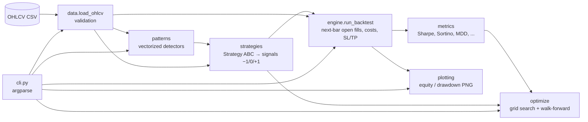
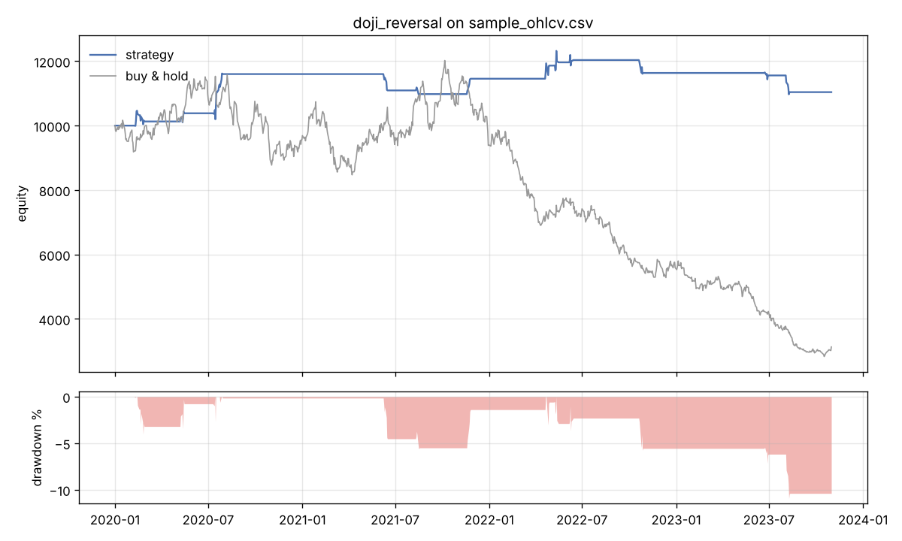
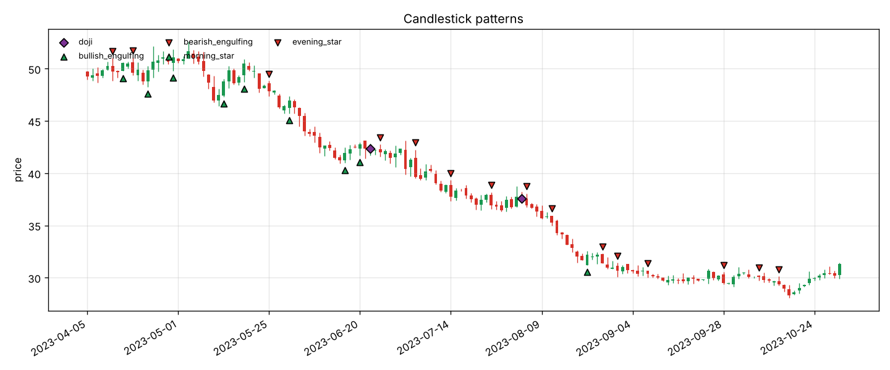

# backtest-lab

**Detect candlestick patterns and backtest them honestly: next-bar execution, costs, risk exits and walk-forward validation, in plain Python.**

[](https://github.com/ariaesm/backtest-lab/actions/workflows/ci.yml)
[](LICENSE)


backtest-lab is a small, readable backtesting engine for candlestick-pattern
strategies. It started as the Python companion to my TradingView indicator
[**ariaesm/Doji-indicator**](https://github.com/ariaesm/Doji-indicator) (Pine Script):
the doji detectors here use the same logic, and you can check how those signals
would have traded once costs and realistic fills are included.

> **Disclaimer: not financial advice.** This is an educational/research tool. Past or
> simulated performance does not predict future results.

## Features

- **Data loading**: OHLCV CSV (`timestamp, open, high, low, close, volume`) with
  clear validation errors (missing columns, non-numeric values, duplicate timestamps,
  `high < close`, and so on).
- **9 vectorized pattern detectors** (pandas/numpy): doji, dragonfly doji, gravestone
  doji, hammer, shooting star, bullish/bearish engulfing, morning star, evening star.
  The doji family follows the Pine script: body average = EMA(14) of body size, doji
  body ≤ 5% of the bar range, and shadow-vs-shadow / shadow-vs-body comparisons.
- **Strategy interface** (`Strategy` ABC + registry) with 3 built-ins:
  `doji_reversal`, `engulfing_trend` (engulfing filtered by EMA trend) and
  `sma_crossover` (baseline).
- **Event-driven engine**: long/short, fixed-fraction sizing, commission, slippage,
  stop-loss / take-profit with gap handling. Signals computed at bar *t* fill at the
  **open of bar t+1**, so there is no look-ahead. Tests check this by truncating the
  data and by changing future prices.
- **Metrics**: total return, CAGR, annualized volatility, Sharpe, Sortino, max
  drawdown, Calmar, win rate, profit factor, number of trades and exposure, each
  unit-tested against hand-computed series.
- **Grid search + walk-forward split**: parameters are chosen on the train window and
  reported on the unseen test window.
- **Charts** (matplotlib → PNG): equity curve with drawdown, and candlesticks with
  pattern markers.
- **CLI**: `backtest-lab run | patterns | optimize | strategies`.

## Architecture



## Quickstart

```bash
git clone https://github.com/ariaesm/backtest-lab.git
cd backtest-lab
python -m pip install -e ".[dev]"     # or: make install

# (re)generate the synthetic sample dataset (seeded, deterministic)
python scripts/generate_sample_data.py

backtest-lab run --data data/sample_ohlcv.csv --strategy doji_reversal --plot out.png
```

Requires Python ≥ 3.11. Runtime dependencies are numpy, pandas and matplotlib only.

### Library usage

```python
from backtest_lab.data import load_ohlcv
from backtest_lab.engine import BacktestConfig, run_backtest
from backtest_lab.strategies import get_strategy

data = load_ohlcv("data/sample_ohlcv.csv")
strategy = get_strategy("engulfing_trend", trend_len=100, hold_bars=5)
result = run_backtest(data, strategy.generate_signals(data), BacktestConfig(stop_loss=0.05))
print(result.metrics["sharpe"], len(result.trades))
```

See [`examples/quickstart.py`](examples/quickstart.py) for a complete script.

## CLI examples

```bash
# Backtest with costs, risk exits and a chart
backtest-lab run --data data/sample_ohlcv.csv --strategy engulfing_trend \
    -p trend_len=100 -p hold_bars=5 --stop-loss 0.05 --take-profit 0.10 \
    --commission 0.0005 --slippage 0.0005 --trades trades.csv --plot equity.png

# Scan for patterns, list recent hits, draw a candlestick chart with markers
backtest-lab patterns --data data/sample_ohlcv.csv --last 10 --plot patterns.png

# Grid search on the first 70% of bars, report on the last 30%
backtest-lab optimize --data data/sample_ohlcv.csv --strategy engulfing_trend \
    -g trend_len=20,50,100 -g hold_bars=5,10,20 --train-frac 0.7

backtest-lab strategies          # list strategies and their default parameters
```

## Example results

> ⚠️ The numbers below come from running the CLI on **`data/sample_ohlcv.csv`, which is
> synthetic** (geometric Brownian motion, seed 42, 1000 daily bars, 2020-01-01 →
> 2023-10-31). They show what the tool outputs. They are **not** evidence that any
> strategy works and are **not predictive**. Over this synthetic series, buy & hold
> returned −68.70%.

Defaults: initial cash 10,000, full-equity sizing, 0.05% commission + 0.05% slippage
per side, no stop-loss/take-profit.

```bash
backtest-lab run --data data/sample_ohlcv.csv --strategy doji_reversal --plot docs/equity.png
```

| Metric        | doji_reversal | engulfing_trend | sma_crossover (long-only) |
|---------------|--------------:|----------------:|--------------------------:|
| Total return  | 10.39%        | 13.80%          | −26.87%                   |
| CAGR          | 2.52%         | 3.32%           | −7.59%                    |
| Volatility    | 6.72%         | 18.62%          | 15.19%                    |
| Sharpe        | 0.40          | 0.27            | −0.44                     |
| Sortino       | 0.66          | 0.38            | −0.59                     |
| Max drawdown  | −10.94%       | −34.76%         | −38.59%                   |
| Calmar        | 0.23          | 0.10            | −0.20                     |
| Win rate      | 60.00%        | 48.89%          | 33.33%                    |
| Profit factor | 1.57          | 1.15            | 0.30                      |
| Trades        | 15            | 45              | 9                         |
| Exposure      | 7.20%         | 56.40%          | 34.30%                    |



Pattern counts on the same series (`backtest-lab patterns`): doji 13, dragonfly 1,
gravestone 1, hammer 3, shooting star 3, bullish engulfing 52, bearish engulfing 63,
morning star 19, evening star 13.



**Walk-forward** (`optimize --strategy engulfing_trend -g trend_len=20,50,100 -g
hold_bars=5,10,20 --train-frac 0.7`): the best in-sample parameters were
`trend_len=100, hold_bars=5`, with Sharpe 0.07 and total return 0.17% on the train window
(2020-01-01 → 2022-09-06). On the out-of-sample window (2022-09-07 → 2023-10-31) the
same parameters had Sharpe 1.15, total return 21.77% and max drawdown −7.63% over 20
trades. The test window is short and the data is random, so a jump like this is
noise, not skill. Walk-forward splits are there to make that kind of gap easy to see.

## How the backtest avoids look-ahead

1. Strategies output a target direction for bar *t* using data up to the close of *t*.
2. The engine changes position at the **open of bar t+1**, with slippage and commission.
3. Stops and targets are checked from the high/low of later bars. If both are hit in
   one bar, the stop is assumed to fill first. Gaps fill at the open.
4. `tests/test_engine.py` checks that results up to bar *t* do not change when later
   bars are removed or altered, and that a signal on the final bar is never executed.

## Development

```bash
make test      # PYTHONPATH=src python -m pytest
make lint      # ruff check + format --check
make format    # ruff format + autofix
make sample    # regenerate data/sample_ohlcv.csv
```

## Roadmap

- [ ] Multi-fold (rolling / anchored) walk-forward and parameter-stability heatmaps
- [ ] Volatility-targeted and ATR-based position sizing; ATR stops
- [ ] More patterns (harami, piercing line / dark cloud cover, three soldiers/crows)
- [ ] Multi-asset portfolio backtests
- [ ] Export Pine Script `alertcondition()` presets from optimized parameters
- [ ] Interactive HTML report

## Related work

- [ariaesm/Doji-indicator](https://github.com/ariaesm/Doji-indicator): the original
  TradingView Pine Script doji indicator that this project extends.

## License

[MIT](LICENSE) © 2026 Aria Esmaeilzadeh
